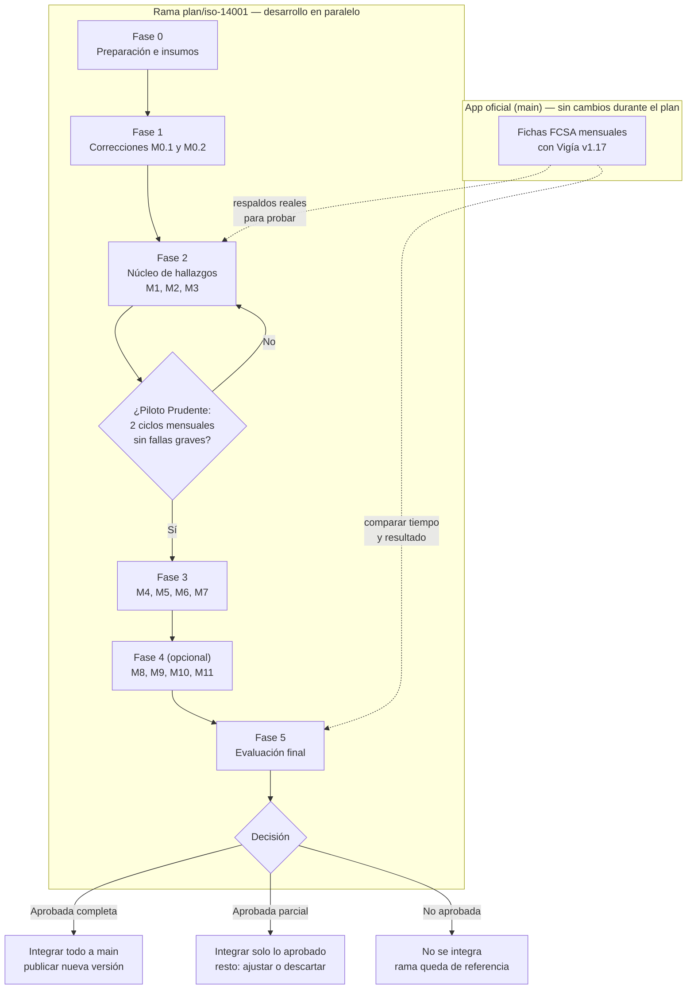
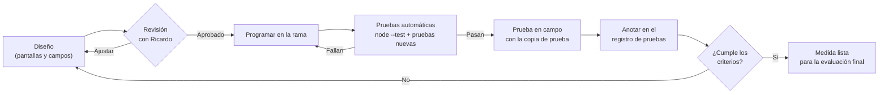

# Plan de trabajo: medidas ISO 14001 en Vigía

| Dato | Valor |
|---|---|
| Versión del plan | 0.1 (borrador para revisión) |
| Fecha | 20 de noviembre de 2026 |
| Responsable | Ricardo Espino G. |
| App de referencia | Vigía v1.17 (rama `main`, publicada) |
| Rama de trabajo | `plan/iso-14001` |
| Estado | Propuesta, pendiente de revisión |

---

## 1. Propósito

Incorporar a Vigía las mejoras que surgen del análisis de la norma ISO 14001:2015 frente a la app, para que el seguimiento ambiental no termine en el registro del hallazgo. Se busca darle seguimiento hasta su cierre, vincularlo a la obligación de origen y medir si las acciones fueron eficaces.

El plan no busca certificar la app ni a la organización. La norma se usa como método y vocabulario. El capítulo 1 de la norma aclara que "no establece criterios específicos de desempeño ambiental ni aumenta ni modifica las obligaciones legales" (ISO 14001:2015, cap. 1, pág. 1, PDF pág. 9). Los límites de 90 % y 80 % siguen saliendo del PA-03, no de la ISO.

## 2. Modalidad de trabajo: en paralelo a la app y con aprobación al final

1. **La app publicada no se toca durante el plan.** La versión de `main` (v1.17) se sigue usando para las fichas oficiales de cada mes.
2. **Las medidas se desarrollan en la rama `plan/iso-14001`** y se prueban en una copia de prueba de Vigía, en paralelo con las fichas reales.
3. **Al final se decide si se aprueba completa o no.** La evaluación (Fase 5) da uno de tres resultados:
   - **Aprobada completa:** todas las medidas pasan a `main` y se publican.
   - **Aprobada parcial:** solo las medidas que cumplieron los criterios pasan a `main`. El resto se ajusta o se descarta.
   - **No aprobada:** nada pasa a `main`. La rama se conserva como referencia.
4. **Antes de programar, cada medida se revisa con Ricardo.** El diseño (pantallas y campos) se aprueba antes del código, y el resultado se revisa antes de darla por terminada.

### 2.1 Aislamiento de la copia de prueba (requisito técnico)

GitHub Pages sirve todo lo de `rikrdoesp-ui.github.io` desde el mismo origen. Una copia de prueba publicada en otra ruta de ese dominio compartiría con la app oficial:

- **La base de datos del teléfono:** IndexedDB, nombre `fcsa-fichas`.
- **La memoria sin conexión:** Cache Storage. El trabajador sin conexión (`sw.js`) borra al activarse todas las cachés cuyo nombre empieza con `vigia-` que no sean la suya. Por eso la versión oficial y la de prueba se borrarían la caché entre sí.

Para que la prueba no ponga en riesgo las fichas reales, la copia de prueba debe:

| Elemento | Oficial | Copia de prueba |
|---|---|---|
| Base de datos (IndexedDB) | `fcsa-fichas` | `fcsa-fichas-prueba` |
| Prefijo de caché (`sw.js`) | `vigia-` | un prefijo que **no** empiece con `vigia-` (ej. `vprueba-`) |
| Marca de los respaldos (`APP_KEY`) | `fcsa-fichas` | `fcsa-fichas-prueba` |
| Aviso visible | — | franja "VERSIÓN DE PRUEBA" en todas las pantallas y en el PDF |

Reglas de respaldos:
- La copia de prueba **puede importar** respaldos oficiales, para probar con fichas reales.
- La app oficial **no debe aceptar** respaldos de la copia de prueba.

Dónde se publica la copia de prueba se decide en la Fase 0.

## 3. Documentos de referencia

| Documento | Uso en el plan | Estado |
|---|---|---|
| ISO 14001:2015, traducción certificada (54 págs.) | Cláusulas que justifican cada medida | Disponible y leída completa |
| PA-02 Plan de Gestión Ambiental, Rev. 02, Prudente (MPA2401C-PGA-PRU-01-2024) | Cita ISO 14001-2015 como norma de referencia (pág. 9). Periodicidad mensual del registro de inspecciones (pág. 121). Monitoreos (págs. 122–123). Informe de emergencias (pág. 99) | Disponible |
| PA-03 Control y Seguimiento Ambiental | Criterios de cumplimiento (§6.2, §6.3) y plan de acción. Necesario para M1, M2 y M4 | **Pendiente de entregar** |
| EsIA, resoluciones y PMA de cada proyecto | Fuente de cada medida (M3) | Pendiente, por proyecto |
| Análisis "Vigía frente a ISO 14001:2015" (20-nov-2026) | Origen de este plan | Realizado |

**Nota sobre la versión de la norma:** la ISO 14001:2026 se publicó el 15 de abril de 2026 y reemplaza a la de 2015. No tenemos el texto de la 2026. Antes de citar cláusulas en un documento oficial, hay que confirmar que la numeración se mantiene.

**Notación de páginas:** "pág. 12 (PDF 20)" quiere decir página impresa 12 de la norma y página 20 del archivo PDF.

## 4. Medidas del plan

| ID | Medida | Base en ISO 14001:2015 | Prioridad | Fase |
|---|---|---|---|---|
| M0.1 | Corregir la cita de "Medidas recurrentes": dice 10.2 y corresponde a **10.1 b) y d)** | 10.1, págs. 22–23 (PDF 30–31) | Alta | 1 |
| M0.2 | Escribir la fórmula de cálculo en el PDF de indicadores | A.9.1.1 b), pág. 39 (PDF 47) | Alta | 1 |
| M1 | Seguimiento de cada hallazgo hasta su cierre: número, estado, acción solicitada, plazo, fecha y foto de cierre, y verificación en la ficha siguiente | 10.1 a)–e), págs. 22–23 | Alta | 2 |
| M2 | Separar corrección de acción correctiva, con un campo opcional "causa" | 3.25, pág. 7 (PDF 15); 10.1 a) y c) | Alta | 2 |
| M3 | Fuente de cada medida en el catálogo (sección del PMA/PGA, artículo de la resolución, COPANIT) | 6.1.3, pág. 12 (PDF 20); A.6.1.3, págs. 32–33 | Alta | 2 |
| M4 | Clasificar la importancia del hallazgo, solo para priorizar y sin alterar el % oficial | 10.1, pág. 23 (PDF 31) | Media | 3 |
| M5 | Etiquetar cada programa con su aspecto o componente ambiental, para comparar proyectos | 6.1.2, págs. 11–12; A.6.1.2, pág. 31 (PDF 39) | Media | 3 |
| M6 | PDF de una página con hallazgos abiertos y plazos para el contratista | 8.1 c), pág. 18 (PDF 26); 7.4.1, pág. 16 (PDF 24) | Media | 3 |
| M7 | Indicadores de eficacia: % cerrados en plazo, días promedio de cierre, reincidencias | 9.3 d), pág. 21 (PDF 29) | Media | 3 |
| M8 | Registro rápido de incidentes (derrames, vertidos) fuera de la lista de medidas | 8.2, págs. 18–19; 6.1.2 b) 2) | Baja | 4 |
| M9 | Control de monitoreos programados: realizado, resultado frente al límite, calibración | A.9.1.2 d), pág. 39; 9.1.1, pág. 19 | Baja | 4 |
| M10 | Registro de quejas de la comunidad vinculadas a una medida | A.7.4, pág. 36; A.9.3, pág. 41 | Baja | 4 |
| M11 | Rutina de retención de respaldos (procedimiento más que código) | 7.5.3, pág. 17 (PDF 25) | Baja | 4 |

### Dependencias

- **M2, M4, M6 y M7** dependen de **M1**, porque necesitan que el hallazgo exista como registro con estado.
- **M1, M2 y M4** deben ajustarse al **PA-03**. Los nombres de estados, los plazos y las categorías salen de ese procedimiento, no se suponen.
- **M3** depende de que Ricardo entregue las fuentes de cada proyecto.
- **M5** requiere acordar la lista de componentes antes de etiquetar.
- **M7** necesita al menos dos ciclos mensuales de M1 con datos reales.

## 5. Flujo de ejecución

### 5.1 Flujo general

### 5.2 Ciclo de cada medida

## 6. Fases

### Fase 0: Preparación e insumos

- **Objetivo:** tener todo lo necesario antes de programar.
- **Actividades:**
  1. Entregar el **PA-03 Control y Seguimiento Ambiental**.
  2. Confirmar **Prudente** como proyecto piloto.
  3. Montar la **copia de prueba aislada** según 2.1 y decidir dónde se publica.
  4. Juntar las **fuentes de las medidas** de Prudente (sección del PGA, resolución, artículo) para M3.
  5. Si se van a citar cláusulas en documentos oficiales, confirmar la numeración en la ISO 14001:2026.
- **Entregables:** copia de prueba funcionando con la base de datos separada; PA-03 en el proyecto; lista de fuentes de Prudente.
- **Criterio de salida:** la copia de prueba abre sin internet en el teléfono y no afecta a la app oficial (verificado con ambas instaladas).

### Fase 1: Correcciones

- **Objetivo:** corregir lo que hoy está mal o incompleto en los indicadores.
- **Actividades:** M0.1 (cita 10.1 b) y d)) y M0.2 (fórmula en el PDF de indicadores).
- **Entregables:** las dos correcciones en la rama, con pruebas automáticas que verifiquen el texto.
- **Criterio de salida:** `node --test` pasa y el PDF de indicadores muestra la fórmula.
- **Nota:** son correcciones de bajo riesgo. Si Ricardo lo decide, pueden adelantarse a `main` sin esperar la Fase 5.

### Fase 2: Núcleo de hallazgos (piloto Prudente)

- **Objetivo:** que cada "No" pueda seguirse hasta su cierre.
- **Actividades:**
  1. **M1:** cada hallazgo con número, estado, acción solicitada, plazo, fecha y foto de cierre. Al crear la ficha del mes siguiente, la app muestra los hallazgos abiertos del proyecto para verificarlos.
  2. **M2:** distinguir corrección de acción correctiva y agregar un campo "causa" opcional.
  3. **M3:** cargar la fuente de cada medida en el catálogo de Prudente.
  4. Mantener el formato oficial FCSA tal como está. El seguimiento va en un registro o anexo aparte.
- **Prueba en campo:** al menos **2 ciclos mensuales** en Prudente. Un hallazgo abierto en un mes solo se puede verificar en la ficha del mes siguiente.
- **Criterio de salida:**
  - Hallazgos abiertos y cerrados de forma completa en dos fichas seguidas.
  - Ninguna pérdida de datos.
  - PDF oficial sin cambios.

### Fase 3: Medidas de prioridad media

- **Objetivo:** priorizar hallazgos, comparar proyectos y comunicar al contratista.
- **Actividades:**
  - **M4:** importancia del hallazgo, con categorías tomadas del PA-03 o acordadas con la Sección.
  - **M5:** aspecto o componente por programa.
  - **M6:** PDF de hallazgos abiertos para el contratista.
  - **M7:** indicadores de eficacia.
- **Criterio de salida:**
  - M6 se usó al menos una vez con el contratista de Prudente.
  - M7 muestra datos reales de los ciclos de la Fase 2.

### Fase 4: Medidas de prioridad baja (opcional)

- **Objetivo:** decidir si M8 a M11 valen la pena antes de desarrollarlas.
- **Actividades:** evaluar cada una. Solo se programan las que Ricardo apruebe. M11 puede resolverse con un procedimiento escrito, sin código.
- **Criterio de salida:** decisión registrada para cada medida (hacer, posponer o descartar).

### Fase 5: Evaluación final y decisión

- **Objetivo:** decidir qué pasa a la app oficial.
- **Actividades:**
  1. Revisar el registro de pruebas (sección 8).
  2. Aplicar los criterios de aprobación (sección 7) a cada medida.
  3. Comparar con la app oficial: tiempo de llenado, tiempo de preparación del informe y problemas encontrados.
  4. Registrar la decisión: aprobada completa, aprobada parcial o no aprobada.
  5. Si se aprueba total o parcialmente:
     - Revertir el aislamiento de prueba (nombres de base de datos, caché y `APP_KEY`).
     - Integrar a `main`.
     - Correr `node tools/publicar.mjs` y `node --test`.
     - Publicar.
     - Verificar en el teléfono que las fichas existentes siguen intactas.
- **Entregable:** acta de decisión, al final de este documento (sección 11).

### Calendario propuesto (a ajustar)

| Fase | Período propuesto |
|---|---|
| Fase 0 | noviembre – diciembre 2026 |
| Fase 1 | diciembre 2026 |
| Fase 2 | diciembre 2026 – febrero 2027 (ciclos de enero y febrero) |
| Fase 3 | febrero – marzo 2027 |
| Fase 4 | marzo 2027 (opcional) |
| Fase 5 | abril 2027 |

Las fechas son una propuesta inicial. Dependen sobre todo de que el PA-03 y las fuentes de las medidas estén disponibles en la Fase 0.

## 7. Criterios de aprobación por medida

Una medida se aprueba si cumple **todos** estos puntos:

- [ ] No cambia el formato oficial de la FCSA ni la forma de calcular el porcentaje de cumplimiento (PA-03).
- [ ] Funciona sin internet en el teléfono y en la tableta.
- [ ] No pierde ni altera fichas existentes, y los respaldos anteriores se siguen importando bien.
- [ ] Pasa las pruebas automáticas existentes y las nuevas que se escriban para ella.
- [ ] Se usó en campo en el piloto, con fichas reales.
- [ ] No aumenta de forma importante el tiempo de llenado en campo, o el tiempo extra se compensa con menos trabajo al preparar el informe.
- [ ] Toda cita que muestre (ISO, PA-02, PA-03) indica documento, apartado y página, y se puede verificar.

## 8. Registro de pruebas

| Fecha | Medida | Proyecto / ficha | Resultado | Problemas encontrados | Acción |
|---|---|---|---|---|---|
| | | | | | |

## 9. Riesgos y cómo se manejan

| Riesgo | Cómo se maneja |
|---|---|
| La copia de prueba borra la caché o los datos de la app oficial (mismo origen) | Aislamiento de la sección 2.1, verificado en la Fase 0 antes de cualquier prueba |
| Se pierde una ficha real durante la prueba | Las fichas oficiales se siguen llenando solo en la app oficial; la copia de prueba trabaja con copias importadas |
| Las medidas no coinciden con el PA-03 | M1, M2 y M4 esperan a tener el PA-03; no se suponen estados, plazos ni categorías |
| Más carga de trabajo en campo | Campos nuevos opcionales donde sea posible; medición del tiempo en el registro de pruebas |
| La numeración de la ISO 14001:2026 difiere de la 2015 | Confirmar antes de citarla en documentos oficiales; la app indica la edición citada |
| El alcance crece durante el plan | Toda medida nueva se agrega a la sección 4 y pasa por el mismo ciclo y los mismos criterios |

## 10. Pendientes

- [ ] Entregar el PA-03 Control y Seguimiento Ambiental.
- [ ] Confirmar Prudente como piloto.
- [ ] Decidir dónde se publica la copia de prueba.
- [ ] Entregar las fuentes de las medidas de Prudente.
- [ ] Definir si M0.1 y M0.2 se adelantan a `main` o esperan a la Fase 5.

## 11. Acta de decisión final

| Medida | Decisión (aprobada / ajustar / descartada) | Observación |
|---|---|---|
| M0.1 | | |
| M0.2 | | |
| M1 | | |
| M2 | | |
| M3 | | |
| M4 | | |
| M5 | | |
| M6 | | |
| M7 | | |
| M8 | | |
| M9 | | |
| M10 | | |
| M11 | | |

**Resultado global:** ☐ Aprobada completa ☐ Aprobada parcial ☐ No aprobada

**Fecha:** ____________ **Firma:** ____________

## 12. Control de cambios del plan

| Versión | Fecha | Cambio |
|---|---|---|
| 0.1 | 20-nov-2026 | Versión inicial |
